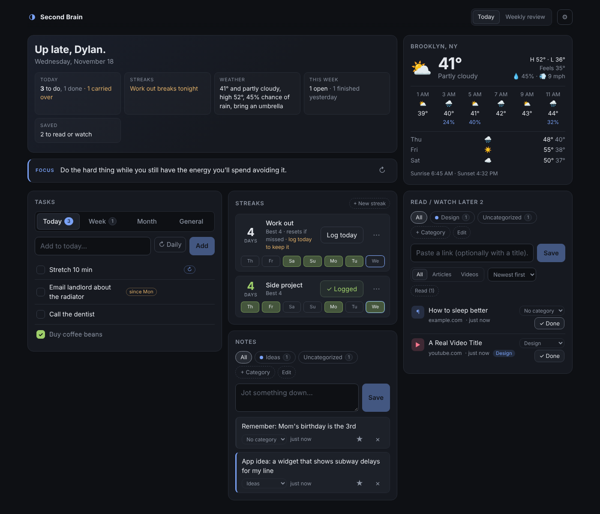

# Dylan's Second Brain

A morning dashboard for phone and desktop: tasks, notes, read/watch-later links, streaks, Brooklyn weather, a daily summary, a focus quote and a weekly review. Classic dark mode.



## Run it

```bash
npm install
npm run dev      # http://localhost:5173
npm run build    # static site in dist/
```

## Deploy

`npm run build` produces a plain static site in `dist/` (relative paths, no server needed). Any static host works:

- **Vercel / Netlify / Cloudflare Pages**: import the repo, build command `npm run build`, output folder `dist`.
- **GitHub Pages** (live at https://dstraffon.github.io/Dylan-s-Second-Brain/): `.github/workflows/deploy.yml` builds and publishes on every push to `main`. One-time setup: repo Settings → Pages → Source → **GitHub Actions**.

On a phone, open the site and use "Add to Home Screen" so it opens like an app.

## Features

- **Tasks**: Today / Week / Month / General tabs, with the quick-add going to whichever tab is open. Toggle ↻ Daily before adding to make a task repeat every day. Unfinished Today tasks carry over with a "since Mon" badge. Finished tasks stay visible (struck through) until their period ends, then drop out of view but stay in the weekly review. Double-click a task to rename it; use the dropdown to move it to another list.
- **Notes**: type and press Enter. Tap a category chip to filter, and new notes go into the selected category. Click a note to edit, ★ to pin.
- **Links**: paste a URL (optionally with a title) and press Enter. YouTube, Vimeo, TikTok, Twitch and similar are tagged as video, everything else as article (tap the icon to switch). Video titles are filled in automatically. Filter by category or type, sort by newest, oldest or category. "Done" hides a link without deleting it; "Read" shows them again.
- **Streaks**: add your own, tap "Log today", or tap any of the last 7 days to fix a missed log. "Reset to 0 if I miss a day" is off by default. With it off, the count is the number of days logged since the last reset. ⋯ → Reset starts over by hand.
- **Daily summary** and **focus quote** at the top. Either can be switched off in Settings; the summary is one self-contained component (`src/components/DailySummary.tsx`).
- **Weekly review**: tasks finished per day, habit grid for streaks and daily tasks, what's still open, and a short reflection saved per week.
- **Weather**: Open-Meteo (no API key), refreshed every 30 minutes.
- **Keyboard**: `t` task, `n` note, `l` link, `r` weekly review, `Esc` back.

## Data

Everything is saved in the browser's localStorage for now, so each device has its own data. Settings → Export / Import backup moves data between devices by hand.

All reads and writes go through `src/lib/storage.ts`. To add sync later (for example Supabase), write a `StorageAdapter` that keeps a local cache and pushes changes to the backend, then call `setStorageAdapter()` in `src/main.tsx`. No feature code needs to change.

## Stack

Vite + React + TypeScript, no other runtime dependencies.
